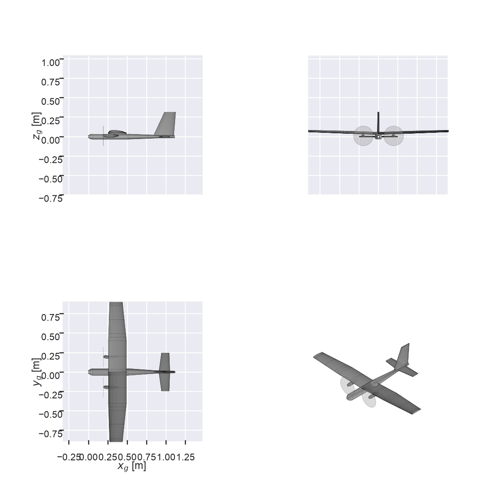
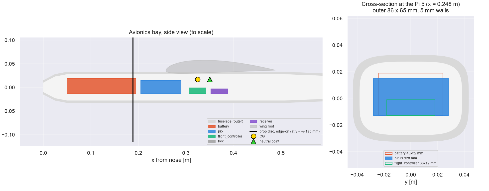
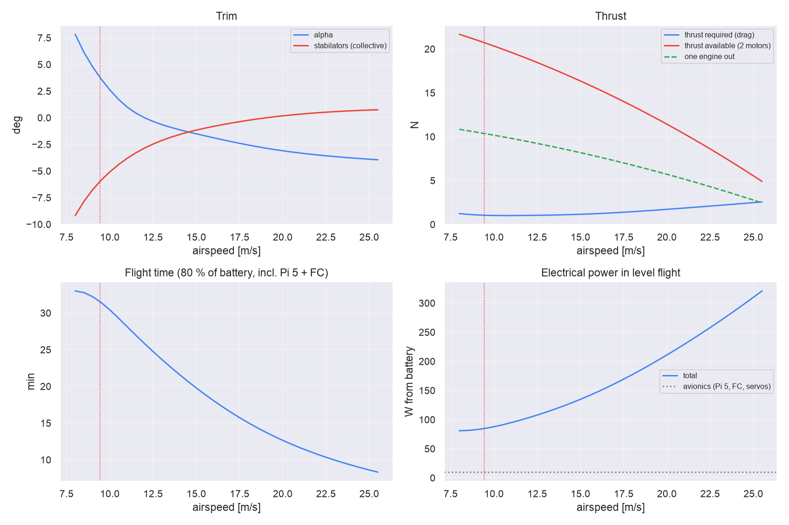
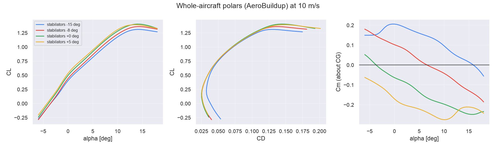
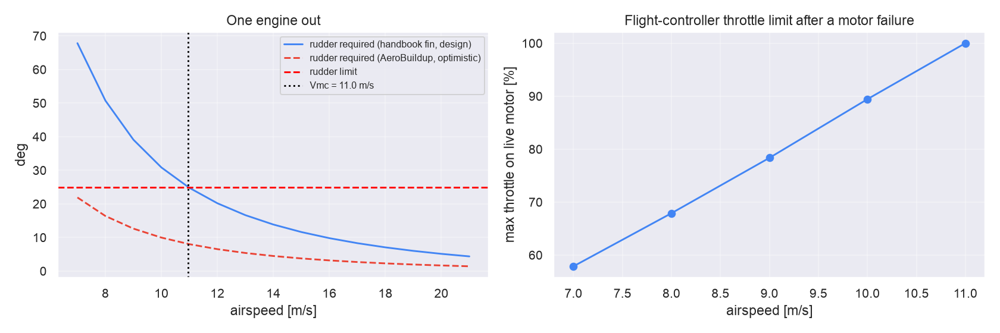
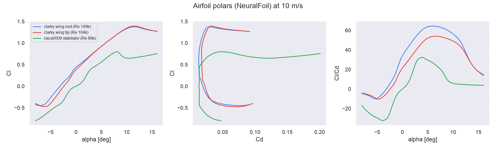
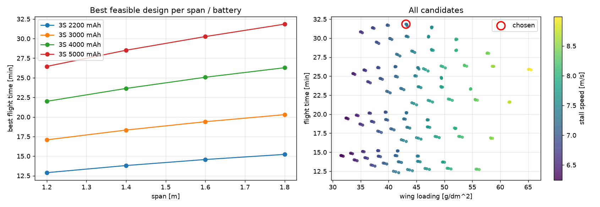

# Twin high-wing RC plane: simulation results

Generated by `python -m twin_rc.run_all`. Don't edit by hand.

## Hardware

- **Motors:** 2x Flite Test Radial 2218 1180Kv v2 (76 g), 10x4.7 2-blade props, counter-rotating, 3S. 40 A ESCs (static draw is 27 A per motor).
- **Battery:** 3S 5000 mAh (44 Wh usable).
- **Avionics:** Raspberry Pi 5 with active cooler (85 mm x 56 mm x 28 mm), flight controller PCB (36 mm x 36 mm), 5 V/5 A BEC, receiver. These draw 9.7 W continuously.

## Dimensions (sized by `python -m twin_rc.sizing`)

| | |
|---|---|
| Wingspan | 1800 mm |
| Wing chord, root / tip | 230 mm / 161 mm (rectangular to 45% semispan) |
| Wing area, aspect ratio, MAC | 0.380 m^2, 8.5, 213 mm |
| Wing leading edge from nose | 258 mm |
| Fuselage length / width / height | 1108 mm / 86 mm / 65 mm |
| Tail arm (wing AC to stabilator AC) | 640 mm |
| Stabilators (each) | 230 mm span, chord 137 mm / 96 mm, LE at 910 mm; total 570 cm^2, Vh 0.45 |
| Fin + rudder | height 298 mm, chord 256 mm / 141 mm, 592 cm^2, Vv 0.055; rudder = aft 40% |
| Motor centrelines | +/-195 mm from the centreline (25 mm prop-tip clearance to the fuselage) |
| Prop plane from nose | 189 mm |
| Nacelle length | 188 mm (motor + 40 A ESC inside) |

## Avionics bay

| Component | Centre x from nose | Size (L x W x H) | Fits |
|---|---|---|---|
| battery | 122 mm | 145 mm x 48 mm x 32 mm | yes |
| pi5 | 248 mm | 85 mm x 56 mm x 28 mm | yes |
| flight_controller | 325 mm | 36 mm x 36 mm x 12 mm | yes |
| bec | 370 mm | 35 mm x 20 mm x 10 mm | yes |
| receiver | 370 mm | 35 mm x 22 mm x 10 mm | yes |

The flight controller sits **0 mm from the CG**, so its IMU measures close to the true CG accelerations. The battery and Pi 5 are up front and set the balance. The space between the Pi and the flight controller is free for GPS, a camera, etc. The Pi needs a cooling-air inlet/outlet in the hatch.

## Performance

| | |
|---|---|
| All-up mass | 1.64 kg, wing loading 43.1 g/dm^2 |
| Trimmed CLmax | 1.32 |
| Stall speed | 7.3 m/s |
| Max flight time (9.5 m/s) | **31.4 min**; 85 W total, of which 10 W is avionics; L/D 15.5 |
| Trim at that speed | alpha 3.6 deg, stabilators -5.9 deg |
| Best L/D | 16.0 at 10.5 m/s |
| Static thrust | 12.8 N per motor, T/W 1.59 |
| Max level speed | 25.5 m/s |
| Level flight on one engine | 8.0-25.0 m/s |

## Stability (at the max-flight-time speed)

- **Static margin 12% MAC.** Neutral point at 350 mm from the VLM with a fuselage correction; CG at 325 mm. AeroBuildup gives 23%, but its downwash model overstates the tail, so the VLM figure is the design value.

| Derivative | Value (per rad) | Want |
|---|---|---|
| Cm_alpha | -1.078 | < 0 |
| Cn_beta | 0.128 | > 0 |
| Cl_beta | -0.056 | < 0 |
| Cm_q | -8.75 | < 0 |
| Cl_p | -0.651 | < 0 |
| Cn_r | -0.099 | < 0 |

## Control power (per degree)

| Surface | Effect |
|---|---|
| Stabilators, collective (+ = TE down) | Cm -0.0238, CL +0.0081 |
| Stabilators, differential (+ = left TE down) | Cl +0.0006 |
| Rudder (+ = TE right) | Cn +0.0048, CY -0.0137 |
| Ailerons | Cl -0.0066, Cn -0.00040 |

## One engine out

The motors sit as close to the fuselage as the props allow, which keeps the asymmetric thrust moment small.

- **Full-power Vmc = 11.0 m/s** (1.51 x stall), using the handbook estimate of rudder power for a low-aspect-ratio fin. Below this, the flight controller should cap the live motor's throttle at the limit in the right-hand plot.
- AeroBuildup predicts about 3x more rudder power (Vmc 7.0 m/s). The fin is sized with the more conservative handbook value.

## Airfoils

| Section | Airfoil | Re | Clmax | max L/D |
|---|---|---|---|---|
| wing root | clarky | 148990 | 1.37 | 64 |
| wing tip | clarky | 104293 | 1.39 | 54 |
| stabilator | naca0009 | 88763 | 0.80 | 32 |

## Mass breakdown

| Item | Mass |
|---|---|
| battery | 400 g |
| wing | 380 g |
| fuselage | 186 g |
| motor_L | 76 g |
| motor_R | 76 g |
| landing_gear | 70 g |
| pi5 | 70 g |
| stabilators | 60 g |
| wiring | 50 g |
| fin_rudder | 41 g |
| esc_L | 40 g |
| esc_R | 40 g |
| servos_tail | 27 g |
| bec | 20 g |
| servos_wing | 18 g |
| nacelle_L | 15 g |
| nacelle_R | 15 g |
| flight_controller | 15 g |
| prop_L | 14 g |
| prop_R | 14 g |
| receiver | 10 g |
| **Total** | **1638 g** |

## Cross-check in XFLR5 / AVL

- XFLR5: File -> Import -> Import from XML -> `exports/twin_rc_xflr5.xml`. Load the airfoil `.dat` files in `exports/` first. The stabilators are exported as one symmetric all-moving tail; set its tilt angle, or make it the control in a T7 stability analysis.
- AVL: `exports/twin_rc.avl`

## Model limits

- The motor's winding resistance and no-load current are estimates. The prop coefficients are calibrated to published 2218 bench data. A thrust-stand run of the real motor and prop should replace them.
- Structure masses assume foam-board construction (see `config.py` areal masses). Weigh the parts as you build and update the config.
- The prop wash over the wing and tail isn't modelled.

## Sizing study

Full sweep: `sizing/sweep.csv`. Chosen point: `sizing/best.json`.
